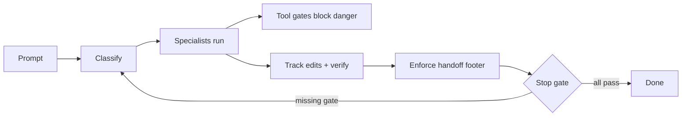

# agnthive

Install — this repo is a self-hosted marketplace, so connect Claude Code and install in one line (the plugin ships disabled by default, so the last step enables it):

```bash
claude plugin marketplace add C0FFEEC0DE/agnthive && claude plugin install agnthive@agnthive && claude plugin enable agnthive@agnthive
```

[](https://github.com/C0FFEEC0DE/agnthive/actions/workflows/validate.yml)
[](https://github.com/C0FFEEC0DE/agnthive/actions/workflows/hooks-test.yml)
[](https://github.com/C0FFEEC0DE/agnthive/actions/workflows/security-scan.yml)

Claude Code with a software engineering discipline built in — a **hook-gated SDLC
profile** wraps every prompt in discover → design → implement → verify → review →
docs, three primary specialists (Code Reviewer, Explorer, Debugger) work under
the gates, and a benchmark suite scores end states so regressions surface before
a release. The gates only run in sessions where the plugin is enabled — it ships
disabled by default.

## How it works



Full diagram and the pieces: [`plugins/agnthive/references/architecture.md`](plugins/agnthive/references/architecture.md).

## Agents

| Alias | Role | Purpose |
|-------|------|---------|
| `@cr` | Code Reviewer | Code review + security |
| `@e` | Explorer | Codebase exploration |
| `@dbg` | Debugger | Debugging issues |

Full names work too: `@code-reviewer`, `@explorer`, `@debugger`.

Those three are the agents the plugin ships. ADR 0008 made them the primary
specialists; **0.5.0 removed the five compatibility agents** (Manager,
Architect, Tester, Docwriter, Bugbuster) after the compatibility window closed,
so there is no second SDLC engine in the runtime any more. The `/manager`,
`/design`, `/test`, `/docs`, `/bug`, and `/refactor` root procedures stay —
they are procedures the root session runs, not agents it spawns. The alias map
carries only the three shipped labels; the removed labels were deleted in ADR
0015, so old benchmark reports remain historical artifacts. See
[`plugins/agnthive/references/agent-contracts.md`](plugins/agnthive/references/agent-contracts.md).

## Usage

```
@e explore the auth module
@cr review api.mjs
@dbg isolate the flaky auth test
/manager implement new feature: user authentication
```

### Slash commands

- `/manager` — manager-led orchestration
- `/explore` — codebase exploration
- `/bug` — bug hunting
- `/debug` — debugging
- `/test` — testing
- `/design` — design
- `/refactor` — refactoring
- `/review` — two-stage review: simplify, then an independent `@cr` pass
- `/simplify` — behavior-preserving reduction (stage 1 of `/review`, runnable alone)
- `/docs` — documentation

These are the documented entry points; the hooks enforce the actual handoff and stop gates. When a benchmark needs a visible role-usage marker, it may also require an explicit `Handoff evidence: @alias ...` line in the transcript.

### Required handoffs

| Type | Required |
|------|----------|
| feature | current verification evidence + a started `@cr` review |
| bugfix | current verification evidence + a started `@cr` review |
| refactor | current verification evidence + a started `@cr` review |
| review | `@cr` |
| docs | current verification evidence when behavior changed |

There are no mandatory role quotas: the root session orchestrates, and
completion is decided by **evidence**, not by roles that were started. The
evidence is read from the plugin's session state (`verification[]` records
scoped to the current change revision and the agent registry), not from footer
text; the footer lines are reporting guidance. The `legacy` profile (mandatory
role quotas, the Manager-idle gate, blocking footer lines) was **removed in
0.5.0** — a session that still names it runs the root-orchestration profile
and prints an explicit migration note.

## Install

This repository is a self-hosted plugin marketplace, so you connect Claude Code
to it directly and install from it — no clone required:

```bash
claude plugin marketplace add C0FFEEC0DE/agnthive
claude plugin install agnthive@agnthive
claude plugin enable agnthive@agnthive   # the plugin ships disabled by default
```

The marketplace name is `agnthive` (the `name` field in
`.claude-plugin/marketplace.json`), so the plugin is installed as
`agnthive@agnthive` (`<plugin>@<marketplace>`). The plugin ships **disabled by
default** (`defaultEnabled: false` in `plugin.json`) so installing it never
silently starts gating your sessions — run `claude plugin enable agnthive@agnthive`
to turn the hooks on. Restart Claude Code after enabling. See
`plugins/agnthive/README.md` for requirements, configuration, the optional
status line, and legacy-migration notes.

### Requirements

- **Claude Code** with plugin support, and **Node.js 22 or newer** on `PATH`
  (the runtime invokes the hooks as `node …module.mjs`).
- **No minimum Claude Code version is declared.** The pinned, validated target
  is `2.1.303`; the version matrix, the evidence class of every row, and what
  is still unverified live in
  [`docs/compatibility.md`](docs/compatibility.md). The plugin ships disabled
  by default, so its hooks only run in sessions where it has been enabled.

### Update

Updates come straight from the repository — re-run a single command after new
commits land on `main`:

```bash
claude plugin update agnthive@agnthive
```

For development from a local checkout, see the
[local/dev install](plugins/agnthive/README.md#installation) path in the plugin
README.

## Configuration

All configuration is **environment variables and the plugin-scoped `userConfig`**. The plugin never reads or writes `~/.claude/settings.json`, so installation is non-destructive.

- **Command policy mode:** `userConfig.enforcement_mode` (default `advisory`) or the `AGNTHIVE_POLICY` env var (`advisory` fail-open vs `enforce` fail-closed on unparseable indirection). The legacy `CLAUDE_CREW_POLICY` alias is still honored.
- **Workflow profile:** `userConfig.workflow_profile` (default `lean`) or the `AGNTHIVE_WORKFLOW_PROFILE` env var selects the SDLC gate shape. `lean` (root orchestration, no mandatory role quotas, verification + review evidence gates stay) is the only profile since 0.5.0: the `legacy` profile was removed after the compatibility window closed, and a session that still names it runs `lean` with an explicit migration note on stderr.
- **Log rotation / ledger size:** `userConfig.log_max_bytes` (1 MiB default) and `userConfig.ledger_max_bytes` (64 KiB default), overridable via `AGNTHIVE_LOG_MAX_BYTES` / `AGNTHIVE_LEDGER_MAX_BYTES` (with `CLAUDE_CREW_*` legacy aliases).
- **Knob precedence:** every tunable knob reads `AGNTHIVE_*` (explicit) > `CLAUDE_CREW_*` (legacy alias) > `CLAUDE_PLUGIN_OPTION_*` (the `userConfig` bridge, lowest priority) — so a `userConfig` value always applies unless an explicit env var overrides it.
- **Progress ledger:** `AGNTHIVE_PROGRESS_FILE` overrides the location; default `<projectDir>/.agnthive/progress.md` (gitignored).
- **Observability:** `Notification` and other runtime hook events write structured JSONL streams under `${CLAUDE_PLUGIN_DATA}/logs` (rotated at `AGNTHIVE_LOG_MAX_BYTES`), not `~/.claude/logs/`.
- See [`plugins/agnthive/README.md`](plugins/agnthive/README.md) for the full knob table and [`plugins/agnthive/references/token-cost.md`](plugins/agnthive/references/token-cost.md) for the spend story.

## Docs

- [`plugins/agnthive/README.md`](plugins/agnthive/README.md) — plugin cheatsheet
- [`plugins/agnthive/references/architecture.md`](plugins/agnthive/references/architecture.md) — how the hooks fit together
- [`plugins/agnthive/references/token-cost.md`](plugins/agnthive/references/token-cost.md) — minimal token spend
- [`docs/benchmarking.md`](docs/benchmarking.md) — benchmark setup, including `make bench-precheck` to reproduce the smoke precheck locally without a model
- [`plugins/agnthive/references/agent-contracts.md`](plugins/agnthive/references/agent-contracts.md) — agent contracts
- [`docs/website.md`](docs/website.md) — hosting the project site at <https://agnthive.run> via GitHub Pages (DNS records + setup)

## Contributing

See [`CONTRIBUTING.md`](CONTRIBUTING.md). Run `make precommit` before a PR — it chains the full self-check (`node scripts/validate.mjs`) plus `make lint`, `make test`, and `make hooks`, with no model or network needed. Report security issues via [`SECURITY.md`](SECURITY.md).

## License

MIT — see [`LICENSE`](LICENSE).
